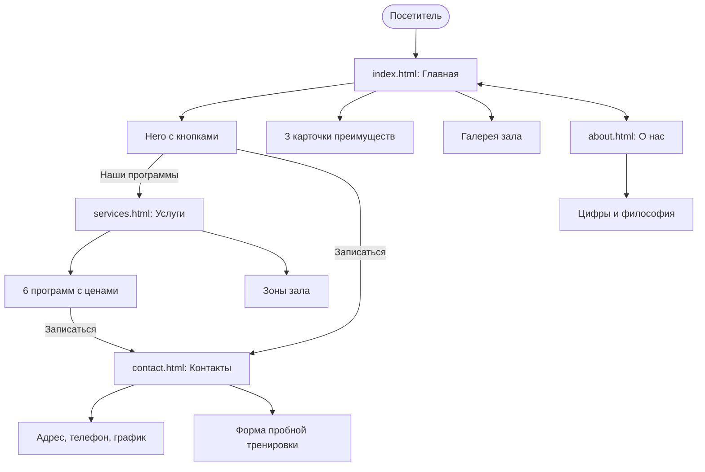
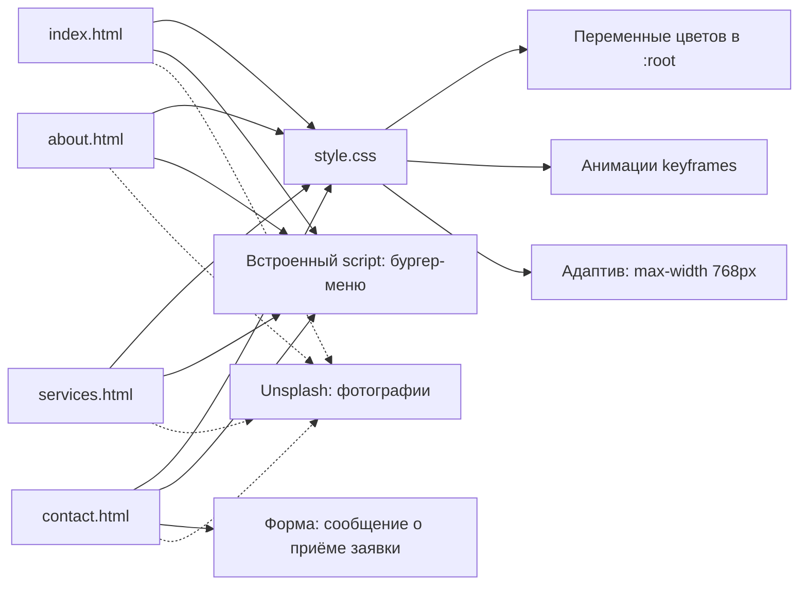

# 💪 PowerFit Gym — сайт фитнес-зала

Многостраничный статический сайт-визитка фитнес-зала на чистом HTML, CSS и JavaScript. Без фреймворков и сборки: достаточно открыть `index.html` в браузере.

## 🚀 Функциональность
- [x] 4 страницы с единой шапкой, подвалом и подсветкой активного пункта меню
- [x] Адаптивный дизайн, бургер-меню на телефоне
- [x] Тёмная тема в фирменных цветах: чёрный и оранжево-красный
- [x] Анимации: пульсирующий логотип, светящийся заголовок, плавающие картинки, всплывающие подписи в галерее
- [x] Карточки преимуществ, галерея зала, цены на абонементы в рублях
- [x] Форма записи на пробную тренировку
- [ ] Переключение темы (в планах)
- [ ] Сохранение заявок в localStorage (в планах)

## 🧱 Технологии
HTML5, CSS3 (переменные, grid, flex, keyframes, media queries), JavaScript для меню, фотографии с Unsplash.

## 📁 Структура проекта
```
Boomfit/
├── index.html      # Главная: hero, преимущества, галерея
├── about.html      # О нас: история, цифры, философия
├── services.html   # Услуги: 6 программ с ценами, зоны зала
├── contact.html    # Контакты: адрес, форма записи
├── style.css       # единая таблица стилей для всех страниц
└── README.md
```

## 🗺️ Диаграммы проекта

### Карта сайта и переходы



### Как устроен код



## 🌿 Git-ветки
| Ветка | Назначение |
|-------|-----------|
| `main` | стабильная версия, из неё публикуется сайт |

Для разработки и экспериментов можно создать ветки `development` и `test`: `git checkout -b development`.

## 🌐 GitHub Pages
Settings → Pages → Branch `main`, папка `/ (root)`.
Адрес: `https://[your-username].github.io/Boomfit`

## 📄 Лицензия
MIT
